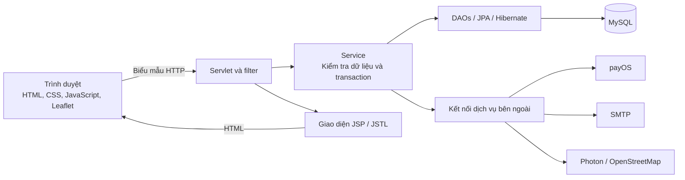

<div align="center">

# Crave — Nền tảng đặt món trực tuyến

**Từ chọn món, đặt hàng và thanh toán đến quản lý cửa hàng.**

[](https://github.com/nguyenvinhz/Servlet_Project_Crave/actions/workflows/deploy.yml)


[Tính năng](#tính-năng) · [Điểm nổi bật kỹ thuật](#điểm-nổi-bật-về-kỹ-thuật) · [Công nghệ](#công-nghệ-sử-dụng) · [Cài đặt](#cài-đặt-và-chạy-dự-án) · [Tài liệu](#tài-liệu)

</div>

Crave là ứng dụng web đặt món trực tuyến được xây dựng bằng **Java Servlet, JSP/JSTL và MySQL**. Khách hàng có thể tùy chỉnh món ăn, áp dụng mã giảm giá, nhận món tại quán hoặc giao tận nơi và thanh toán bằng mã QR qua payOS. Nhân viên quản lý thực đơn, đơn hàng, khuyến mãi và tài khoản thông qua trang quản trị có phân quyền.

Đây là dự án nhóm kết hợp phát triển ứng dụng, thiết kế cơ sở dữ liệu quan hệ, tích hợp dịch vụ bên ngoài, kiểm thử tự động và triển khai lên AWS EC2 bằng GitHub Actions. Giao diện khách hàng và quản trị đều sử dụng tiếng Việt.

## Tính năng

### Dành cho khách hàng

| Nhóm chức năng | Mô tả |
| --- | --- |
| Tài khoản | Đăng ký có xác thực OTP qua email, đăng nhập/đăng xuất, quên và đổi mật khẩu, chỉnh sửa hồ sơ, lưu địa chỉ và chọn địa chỉ mặc định. |
| Thực đơn | Tìm món theo từ khóa, lọc theo danh mục, xem chi tiết và chọn các tùy chọn đi kèm. |
| Giỏ hàng và mã giảm giá | Thay đổi số lượng, tùy chọn và ghi chú; áp dụng mã giảm giá đủ điều kiện; xem tổng tiền trước khi đặt hàng. |
| Nhận món và giao hàng | Chọn lấy tại quán hoặc giao tận nơi, tìm địa chỉ, xác nhận điểm nhận trên bản đồ và xem phí giao hàng. |
| Đặt hàng và thanh toán | Đặt hàng với lựa chọn thanh toán tiền mặt hoặc QR qua payOS, theo dõi trạng thái thanh toán và xem lại chi tiết đơn. |
| Lịch sử đơn hàng | Xem đơn đã đặt và lịch sử trạng thái; hủy đơn khi trạng thái hiện tại cho phép. |

### Quản lý cửa hàng

- **Thực đơn:** quản lý món ăn, danh mục, tùy chọn, giá bán và trạng thái kinh doanh.
- **Đơn hàng và thanh toán:** xử lý đơn, cập nhật trạng thái và quản lý thông tin thanh toán.
- **Khuyến mãi:** thiết lập hình thức giảm giá, thời gian hiệu lực, điều kiện giá trị đơn và trạng thái mã giảm giá.
- **Tài khoản và phân quyền:** quản lý khách hàng, nhân viên; phân quyền theo nghiệp vụ thực đơn, đơn hàng, khuyến mãi và nhân sự.
- **Báo cáo:** xem tổng hợp doanh thu, thống kê đơn hàng và các món bán chạy.

## Điểm nổi bật về kỹ thuật

- **Đặt hàng trong một giao dịch.** Máy chủ khóa giỏ hàng, kiểm tra lại tùy chọn món và mã giảm giá, tính lại tổng tiền, sau đó tạo đơn, bản ghi thanh toán và lịch sử trạng thái ban đầu trong cùng một transaction. Khi xảy ra lỗi, các thay đổi được hoàn tác.
- **Tính tiền chính xác và giữ nguyên thông tin đơn cũ.** Giá trị tiền sử dụng `BigDecimal` và kiểu `DECIMAL` của MySQL. Chi tiết đơn lưu tên món, tên tùy chọn và giá tại thời điểm đặt để việc thay đổi thực đơn không làm thay đổi đơn đã mua.
- **Xác thực bằng phiên đăng nhập.** Mật khẩu được băm bằng PBKDF2-HMAC-SHA256 kèm salt. ID phiên được đổi khi đăng nhập; cookie sử dụng `HttpOnly` và `SameSite=Lax`. Các thao tác cần bảo vệ đều kiểm tra quyền sở hữu dữ liệu và quyền nhân viên tại máy chủ.
- **Xác thực email.** Luồng đăng ký và xử lý mật khẩu sử dụng OTP có thời hạn, chỉ dùng một lần, giới hạn số lần nhập sai và gửi lại. Mã được lưu dưới dạng HMAC kèm salt.
- **Đối soát thanh toán.** Tích hợp payOS xác minh chữ ký webhook, đối chiếu trạng thái và số tiền với cổng thanh toán trước khi cập nhật dữ liệu.
- **Giao hàng theo vị trí.** Leaflet, Photon và OpenStreetMap hỗ trợ tìm địa chỉ, chọn điểm nhận trên bản đồ. Phí giao hàng tính theo khoảng cách đường chim bay bằng công thức Haversine trong bán kính phục vụ 10 km và được tính lại khi đặt hàng.
- **Triển khai từ bản build đã kiểm thử.** CI build và kiểm thử WAR, tạo mã kiểm tra SHA-256, sau đó chuyển đúng bản WAR đó sang quy trình triển khai EC2. Script triển khai khôi phục WAR và cấu hình trước nếu quá trình thay ứng dụng hoặc kiểm tra trạng thái ứng dụng thất bại.

## Công nghệ sử dụng

| Thành phần | Công nghệ |
| --- | --- |
| Ngôn ngữ và môi trường chạy | Java 17, Apache Tomcat 10.1 |
| Web | Jakarta Servlet 6.0, JSP, JSTL, HTML, CSS, JavaScript |
| Truy cập và lưu trữ dữ liệu | Jakarta Persistence 3.1, Hibernate 6.6, HikariCP, MySQL 8.4 |
| Tích hợp | payOS, Jakarta Mail / SMTP, Leaflet, Photon GeoJSON, OpenStreetMap, ZXing |
| Kiểm thử | JUnit 5, Mockito, kiểm thử tích hợp MySQL, kiểm thử HTTP và trình duyệt bằng Node.js |
| Build và triển khai | Maven, đóng gói WAR, Docker Compose, GitHub Actions, AWS EC2 |

## Kiến trúc

Ứng dụng tổ chức theo mô hình MVC. Servlet xử lý yêu cầu HTTP, service thực hiện nghiệp vụ và quản lý transaction, DAO truy cập cơ sở dữ liệu qua JPA. JSP/JSTL hiển thị giao diện từ dữ liệu trong request và session.



Biểu mẫu gửi dữ liệu bằng POST và chuyển hướng sau khi ghi thành công. Bản đồ và trạng thái thanh toán được cập nhật bằng các phần HTML do máy chủ trả về. Các dịch vụ bên ngoài sử dụng định dạng theo giao thức tương ứng như JSON, GeoJSON và PNG.

### Cấu trúc dự án

```text
Servlet_Project_Crave/
├── pom.xml                         # Một dự án Maven duy nhất, tạo crave.war
├── src/
│   ├── main/
│   │   ├── java/vn/edu/crave/
│   │   │   ├── controller/         # Servlet khách hàng và quản trị
│   │   │   ├── model/
│   │   │   │   ├── entity/         # Entity nghiệp vụ dùng JPA
│   │   │   │   ├── dao/            # Truy cập cơ sở dữ liệu
│   │   │   │   ├── service/        # Nghiệp vụ và transaction
│   │   │   │   └── ...             # Form, view model, validator, enum
│   │   │   ├── integration/        # Tích hợp thanh toán, email, bản đồ
│   │   │   └── ...                 # Cấu hình, filter, bảo mật, tiện ích
│   │   ├── resources/              # Cấu hình JPA và ghi log
│   │   └── webapp/                 # Giao diện JSP, CSS, JavaScript, hình ảnh
│   ├── test/java/                  # Kiểm thử đơn vị và tích hợp database
│   └── dev/java/                   # Máy chủ phát triển và công cụ tài khoản
├── database/                       # Schema, dữ liệu mẫu, migration
├── scripts/                        # Chạy local và triển khai EC2
├── tests/                          # Kiểm thử HTTP, trình duyệt, triển khai
├── docs/                           # Hướng dẫn kỹ thuật, báo cáo đóng góp
├── .github/workflows/              # Quy trình CI và triển khai
├── .env.example                    # Cấu hình mẫu
└── compose.yaml                    # MySQL và dịch vụ Tomcat tùy chọn
```

Kết quả build, dữ liệu chạy local, cấu hình IDE và `.env` được loại trừ khỏi Git.

## Cài đặt và chạy dự án

### Yêu cầu môi trường

- **JDK 17 hoặc 21** và **Maven** có trong `PATH`. Trên Windows, đặt `JAVA_HOME` trỏ đến thư mục cài đặt JDK.
- **Docker kèm Compose v2** để khởi tạo cơ sở dữ liệu theo hướng dẫn bên dưới, hoặc một máy chủ MySQL 8+ có sẵn.
- **Node.js 24** nếu chạy kiểm thử HTTP; thêm **Chrome, Chromium hoặc Edge** nếu chạy kiểm thử trình duyệt.

Script phát triển tự build WAR và khởi động Tomcat nhúng, nên khi chạy local bạn không cần cài Tomcat riêng.

### 1. Tải mã nguồn và cấu hình

```bash
git clone https://github.com/nguyenvinhz/Servlet_Project_Crave.git
cd Servlet_Project_Crave
```

Tạo file cấu hình local:

```powershell
# Windows PowerShell
Copy-Item .env.example .env
```

```bash
# Linux / macOS
cp .env.example .env
```

Chỉnh sửa `.env` theo môi trường của bạn:

| Biến cấu hình | Mục đích |
| --- | --- |
| `MYSQL_ROOT_PASSWORD`, `CRAVE_DB_USER`, `CRAVE_DB_PASSWORD` | Thông tin đăng nhập MySQL trong Compose và kết nối ứng dụng. Đặt mật khẩu riêng cho môi trường của bạn. |
| `DB_URL`, `DB_USER`, `DB_PASSWORD` | Ghi đè thông tin kết nối khi sử dụng máy chủ MySQL có sẵn. |
| `EMAIL_SMTP_*`, `EMAIL_FROM`, `EMAIL_OTP_SECRET` | Gửi email và xác thực OTP cho đăng ký, quên và đổi mật khẩu. Khóa OTP cần là chuỗi ngẫu nhiên dài ít nhất 32 ký tự và giữ ổn định giữa các lần khởi động. |
| `PAYOS_CLIENT_ID`, `PAYOS_API_KEY`, `PAYOS_CHECKSUM_KEY`, `PAYOS_PUBLIC_BASE_URL` | Cấu hình thanh toán QR. URL ứng dụng phải gồm `/crave`; để nhận webhook, URL cần truy cập được từ Internet. |
| `CRAVE_STORE_ADDRESS`, `CRAVE_STORE_LATITUDE`, `CRAVE_STORE_LONGITUDE` | Địa chỉ và tọa độ cửa hàng dùng để tính khoảng cách, phí giao hàng. |

Có thể dùng máy chủ SMTP mô phỏng để kiểm thử local theo phần [Kiểm thử](#kiểm-thử). Không đưa `.env` và thông tin xác thực thật lên Git.

### 2. Khởi động MySQL

```bash
docker compose up -d mysql
docker compose ps
```

Chờ MySQL chuyển sang trạng thái `healthy`. Khi khởi động lần đầu với volume trống, Compose tự động chạy `database/schema.sql` và `database/seed.sql`.

> `schema.sql` xóa và tạo lại cơ sở dữ liệu `crave`. Chỉ dùng để khởi tạo môi trường mới hoặc môi trường thử nghiệm có thể xóa dữ liệu. Với cơ sở dữ liệu đang có dữ liệu cần giữ, hãy xem và áp dụng các script phù hợp trong [`database/migrations/`](database/migrations/).

Nếu sử dụng MySQL có sẵn thay cho Docker, khởi tạo một cơ sở dữ liệu phát triển mới bằng schema và dữ liệu mẫu, sau đó cấu hình các biến kết nối ở trên.

### 3. Khởi động ứng dụng

**Windows PowerShell**

```powershell
powershell -ExecutionPolicy Bypass -File scripts/dev/run.ps1 -Port 8081
```

**Linux / macOS**

```bash
bash scripts/dev/run.sh 8081
```

| Trang | Địa chỉ local |
| --- | --- |
| Thực đơn | <http://localhost:8081/crave/menu> |
| Đăng ký | <http://localhost:8081/crave/auth/register> |
| Đăng nhập | <http://localhost:8081/crave/auth/login> |
| Quản trị | <http://localhost:8081/crave/admin> |
| Kiểm tra trạng thái | <http://localhost:8081/crave/health> |

Khi hoạt động bình thường, đường dẫn kiểm tra trạng thái trả về `application=UP` và `database=UP`. Chức năng tìm địa chỉ và tải nền bản đồ cần kết nối đến các dịch vụ bản đồ bên ngoài.

### 4. Tạo tài khoản quản trị

Sau khi cấu hình cơ sở dữ liệu phát triển, chạy:

```powershell
powershell -ExecutionPolicy Bypass -File scripts/dev/create-admin.ps1 -Email admin@example.com -FullName "Crave Admin" -Phone 0901234567
```

Công cụ sẽ yêu cầu nhập mật khẩu và ẩn nội dung khi nhập. Dùng tài khoản vừa tạo để đăng nhập và mở `/admin`. Các tài khoản trong dữ liệu mẫu chưa có mật khẩu hợp lệ để đăng nhập.

## Kiểm thử

Sử dụng cơ sở dữ liệu riêng cho phát triển/kiểm thử, đã nạp schema và dữ liệu mẫu. Kiểm thử tích hợp và kiểm thử luồng ứng dụng có tạo hoặc thay đổi dữ liệu thử nghiệm.

```bash
# Kiểm thử đơn vị và tích hợp MySQL bằng Maven
mvn -Pdev verify

# Kiểm thử giao diện bản đồ độc lập, không cần ứng dụng, database hoặc SMTP
node tests/frontend/delivery-map-browser-smoke.cjs
```

Script kiểm thử trình duyệt dùng các thư viện có sẵn của Node.js và điều khiển Chrome/Edge qua DevTools Protocol. Nếu không tự phát hiện được trình duyệt, đặt `CHROME_PATH` trỏ đến file thực thi tương ứng.

<details>
<summary><strong>Kiểm thử các luồng chính qua HTTP và trình duyệt trên local (PowerShell)</strong></summary>

Các kiểm thử này chạy trên ứng dụng đã đóng gói, bao gồm đăng ký bằng OTP, chỉnh sửa giỏ hàng, đặt món lấy tại quán và hủy đơn. Mở ba cửa sổ terminal tại thư mục gốc dự án.

Trong `.env` của môi trường thử nghiệm này, để trống thông tin đăng nhập SMTP vì máy chủ mô phỏng không hỗ trợ xác thực SMTP:

```dotenv
EMAIL_SMTP_USERNAME=
EMAIL_SMTP_PASSWORD=
```

**Cửa sổ 1 — khởi động máy chủ SMTP mô phỏng:**

```powershell
node tests/runtime/smtp-fixture.cjs
```

**Cửa sổ 2 — chạy ứng dụng với cơ sở dữ liệu kiểm thử và cấu hình email mô phỏng:**

```powershell
$env:EMAIL_SMTP_HOST = '127.0.0.1'
$env:EMAIL_SMTP_PORT = '2525'
$env:EMAIL_SMTP_STARTTLS = 'false'
$env:EMAIL_SMTP_USERNAME = ''
$env:EMAIL_SMTP_PASSWORD = ''
$env:EMAIL_FROM = 'smoke@crave.example'
$env:EMAIL_OTP_SECRET = 'local-smoke-only-otp-secret-32-chars'
powershell -ExecutionPolicy Bypass -File scripts/dev/run.ps1 -Port 8081
```

**Cửa sổ 3 — chạy kiểm thử sau khi ứng dụng và cơ sở dữ liệu đều báo UP:**

```powershell
$env:CRAVE_SMOKE_BASE_URL = 'http://127.0.0.1:8081/crave'
$env:CRAVE_SMOKE_INBOX_URL = 'http://127.0.0.1:2526'
node tests/runtime/http-smoke.cjs
node tests/frontend/servlet-form-browser-smoke.cjs
```

Để kiểm thử thêm các thao tác quản trị, đặt `CRAVE_SMOKE_ADMIN_EMAIL` và `CRAVE_SMOKE_ADMIN_PASSWORD` theo tài khoản quản trị thử nghiệm ở cửa sổ 3. Dữ liệu chẩn đoán trình duyệt được ghi vào `.runtime/`.

</details>

[Quy trình CI](.github/workflows/ci.yml) còn kiểm tra giỏ hàng/khuyến mãi, cú pháp JavaScript, khả năng chạy lặp migration và các kịch bản triển khai/khôi phục. Dừng máy chủ phát triển trước khi chạy `mvn clean` vì thư mục làm việc của Tomcat nằm trong `target/`.

## Triển khai

Build và kiểm thử bản triển khai khi cơ sở dữ liệu kiểm thử đang hoạt động:

```bash
mvn -Pdev verify
```

Kết quả là **`target/crave.war`**, có thể triển khai lên Tomcat 10.1. Để chạy ứng dụng đã đóng gói bằng các dịch vụ Compose có sẵn:

```bash
docker compose --profile production up -d
```

Địa chỉ mặc định là <http://localhost:8080/crave/menu>. Nếu dùng thanh toán QR, cập nhật `PAYOS_PUBLIC_BASE_URL` đúng với URL ứng dụng, bao gồm đường dẫn `/crave`.

Kho mã nguồn cũng có quy trình tự động triển khai lên EC2:

```text
Pull request vào main → Kiểm tra CI
Push / merge vào main → CI → WAR + SHA-256 → Runner EC2 → Kiểm tra trạng thái → Đăng ký webhook payOS
```

Để triển khai thực tế, cần cấu hình self-hosted runner, môi trường `production` và các khóa tích hợp. Xem [hướng dẫn triển khai EC2](docs/project/ci-cd-ec2.md) và [quy trình triển khai](.github/workflows/deploy.yml) để biết cách thiết lập và khôi phục bản trước.

## Tài liệu

| Tài liệu | Nội dung |
| --- | --- |
| [Mục lục tài liệu](docs/README.md) | Hướng dẫn kỹ thuật, kế hoạch và báo cáo phát triển. |
| [Quy ước Servlet và biểu mẫu](docs/architecture/servlet-forms.md) | Đường dẫn trang, trường dữ liệu, quy tắc xác thực và các điểm tích hợp. |
| [Sơ đồ lớp nghiệp vụ](docs/architecture/class-diagram.drawio) | Các entity và quan hệ giữa chúng; mở bằng diagrams.net. |
| [Giao hàng và chỉnh sửa giỏ hàng](docs/architecture/delivery-and-cart-editing.md) | Cách tính phí giao hàng, hoạt động của bản đồ và tùy chỉnh giỏ hàng. |
| [Xác thực email](docs/project/email-verification.md) | Cấu hình SMTP và các luồng OTP. |
| [Tích hợp payOS](docs/project/payos.md) | Cấu hình thanh toán, callback và xử lý trạng thái. |
| [CI/CD trên AWS EC2](docs/project/ci-cd-ec2.md) | Thiết lập runner, khóa tích hợp, triển khai, kiểm tra trạng thái và khôi phục. |
| [Báo cáo đóng góp](docs/reports/README.md) | Báo cáo công việc và đánh giá theo nhóm chức năng. |

Các đường dẫn và lệnh trong README này áp dụng cho cấu trúc hiện tại với một WAR duy nhất; một số hướng dẫn chi tiết và báo cáo cũ vẫn nhắc đến cấu trúc trước đây.

## Thành viên và phân công

Crave được phát triển theo nhóm, với phạm vi phụ trách chính chia theo chức năng:

| Thành viên | Phạm vi phụ trách chính |
| --- | --- |
| Nguyễn Quang Vinh | Tài khoản, xác thực, hồ sơ và sổ địa chỉ. |
| Nguyễn Minh Huân | Thực đơn, danh mục, tùy chọn món và quản trị thực đơn. |
| Ung Văn Trí | Tùy chỉnh giỏ hàng, mã giảm giá và kiểm tra điều kiện khuyến mãi. |
| Nguyễn Đức Phát | Đặt hàng, quản lý đơn và thanh toán. |

Các thành viên phối hợp tích hợp chức năng, rà soát mã nguồn và xây dựng hạ tầng dùng chung. Chi tiết được ghi trong [báo cáo đóng góp](docs/reports/README.md) và [lịch sử commit](https://github.com/nguyenvinhz/Servlet_Project_Crave/commits/main/).
