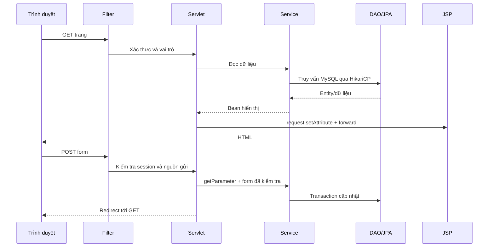

# Servlet/JSP hiện hành

Backend dùng Servlet/JSP trực tiếp, giữ JPA/Hibernate và pool HikariCP. Không dùng Spring MVC, REST controller hay lớp mapper. Các bean chỉ mang dữ liệu form hoặc dữ liệu hiển thị; entity JPA nằm riêng trong `model`.

## Luồng xử lý



Một số lỗi validation được forward lại cùng JSP để giữ nội dung nhập; các trang quản trị đưa thông báo vào session rồi redirect. JSP dùng JSTL và escape dữ liệu người dùng bằng `c:out`. Servlet không trả envelope JSON cho trình duyệt.

## Trách nhiệm

- `servlet`: `doGet`/`doPost`, parameter, session, request attribute, forward và redirect.
- `filter`/`security`: encoding UTF-8, làm mới thông tin tài khoản, phân quyền, kiểm tra sở hữu qua service và kiểm tra Origin cho thao tác ghi.
- `bean`: `*Form` cho dữ liệu nhập và `*Bean` cho JSP; không chứa hash/mật khẩu trong dữ liệu hiển thị.
- `service`/`validator`: kiểm tra nghiệp vụ, trạng thái tài khoản/đơn, voucher, tùy chọn, phí giao hàng và tổng tiền.
- `model`/`dao`: entity, truy vấn và lưu bằng JPA; các service quản trị/thống kê hiện cũng dùng `EntityManager` trực tiếp.
- `config`/`listener`: tạo một `EntityManagerFactory`, cấu hình HikariCP, xác minh database khi khởi động và đóng pool khi ứng dụng dừng.
- `integration`: HTTP tới payOS/geocoder và SMTP gửi mã xác minh.

Giỏ, giá món, phí giao hàng, voucher và tổng đơn được máy chủ kiểm tra lại khi checkout. ID khách/nhân viên thực hiện lấy từ session. Đổi vai trò hoặc khóa tài khoản áp dụng ở request bảo vệ tiếp theo.

## Route

Đường dẫn dưới đây không gồm context path `/crave`. GET hiển thị HTML, POST nhận form `application/x-www-form-urlencoded`, trừ các ngoại lệ ghi rõ.

| Route | GET | POST | Quyền |
|---|---|---|---|
| `/menu`, `/menu/detail?id=...` | Danh sách/chi tiết món | — | Công khai |
| `/promotions` | Danh sách khuyến mãi | — | Công khai |
| `/auth/register`, `/auth/login` | Form tài khoản | Đăng ký/đăng nhập | Công khai |
| `/auth/logout` | — | Hủy session | Session hiện tại |
| `/auth/forgot-password` | Form quên mật khẩu | Gửi mã/đặt lại mật khẩu | Công khai |
| `/auth/change-password` | Form đổi mật khẩu | Gửi mã/đổi mật khẩu | Đã đăng nhập |
| `/customer/profile` | Hồ sơ | Lưu hồ sơ khách | Đã đăng nhập |
| `/customer/addresses` | Địa chỉ/form sửa | Lưu, xóa, chọn mặc định | Khách |
| `/cart`, `/cart/` | Giỏ hiện tại | Thao tác giỏ theo form | Khách |
| `/cart/items`, `/cart/clear` | — | Thêm/sửa/xóa món hoặc xóa giỏ | Khách |
| `/cart/promotion` | — | Áp dụng/gỡ mã giảm giá | Khách |
| `/checkout` | Form và kết quả báo phí | Kiểm tra giỏ và tạo đơn | Khách |
| `/orders`, `/orders/{id}` | Danh sách/chi tiết đơn của mình | — | Khách |
| `/orders/{id}/cancel` | — | Hủy đơn và lý do | Khách sở hữu đơn |
| `/payments/payos/{orderId}` | Đồng bộ trạng thái rồi redirect | Tạo liên kết rồi redirect | Khách sở hữu đơn |
| `/payments/payos/{orderId}/qr` | Ảnh PNG QR | — | Khách sở hữu đơn |
| `/admin` | Tổng quan; nhân viên chuyển tới chức năng theo vai trò | — | Nhân viên |
| `/admin/reports` | Báo cáo theo `from`/`to`; `download=csv` tải CSV | — | ADMIN |
| `/admin/menu`, `/admin/categories` | Danh sách, bộ lọc, form sửa và tùy chọn | Tạo/sửa/xóa/đổi trạng thái | MENU_MANAGER |
| `/admin/customers`, `/admin/employees` | Danh sách và bộ lọc | Trạng thái khách; tạo/đổi vai trò/trạng thái nhân viên | HR_MANAGER |
| `/admin/promotions` | Danh sách, bộ lọc và form sửa | Tạo/sửa/bật/tắt khuyến mãi | PROMOTION_MANAGER |
| `/admin/orders` | Danh sách và chi tiết đơn | Cập nhật trạng thái đơn | ORDER_STAFF |
| `/admin/payments` | — | Cập nhật trạng thái thanh toán | ORDER_STAFF |
| `/health`, `/api/health` | Trạng thái database bằng văn bản | — | Công khai |
| `/api/payos/webhook` | — | JSON do payOS gửi, xác thực bằng chữ ký | payOS |

ADMIN được phép truy cập mọi chức năng nhân viên. Các vai trò ghi trong bảng là quyền chuyên trách. Khách chưa đăng nhập được chuyển tới `/auth/login?returnTo=...`; thiếu quyền trả trang lỗi HTTP 403.

Các form quản trị dùng `action` để chọn thao tác. Ví dụ:

```text
POST /admin/menu
action=status&id=F01&status=UNAVAILABLE

POST /admin/employees
action=role&id=NV02&role=MENU_MANAGER

POST /admin/promotions
action=status&id=KM01&status=INACTIVE
```

## JSON và tích hợp

Jackson chỉ dùng trong giao tiếp máy chủ với payOS/geocoder và xử lý webhook có chữ ký. `IntegrationJson` thuộc `util`, không được dùng để đọc form hay ghi response cho các trang người dùng. SMTP tiếp tục gửi email qua Java Mail.

Thanh toán vẫn cần JSON theo giao thức của payOS; ảnh QR cho trình duyệt được Servlet tạo thành PNG. Không còn các endpoint JSON cho đăng nhập, hồ sơ, giỏ, món, voucher, đơn hàng hoặc quản trị.

## Kiểm chứng khi sửa

Chạy `mvn -f backend/pom.xml clean verify` để kiểm tra Java/JPA. Sau đó chạy ứng dụng thật và bộ kiểm thử trong `tests/runtime`, `tests/frontend` để kiểm tra JSP, session, form POST/redirect và tải CSV. Build WAR đơn thuần chưa kiểm chứng được toàn bộ biểu thức JSP; cần lượt render trên Tomcat.

Các file OpenAPI và báo cáo trước đợt chuyển đổi là tài liệu lịch sử. Không dùng các route `/api/auth`, `/api/cart`, `/api/orders` hoặc `/api/admin/*` trong mã trình duyệt mới.
